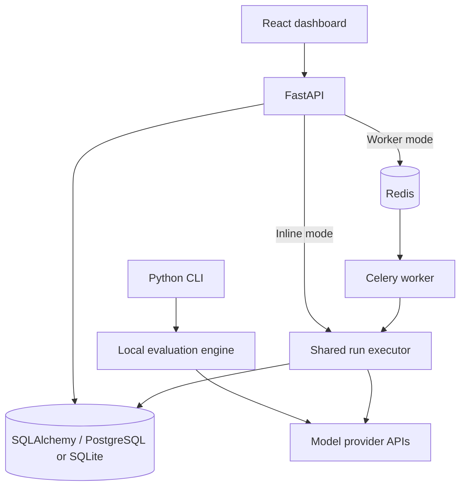

# DriftWatch

Evaluate model responses, store test results, and compare results across runs.

[](https://github.com/sahelmain/DriftWatch/actions/workflows/ci.yml)
[](LICENSE)

## Features

- **Evaluations** — define test suites in YAML and run them locally or through the website
- **Results** — check assertions and store pass rates, response times, token counts, and configured cost estimates
- **History** — view website run timelines or compare saved JSON results with the local drift command
- **Alerts** — send threshold alerts through configured Slack, email, PagerDuty, or Jira channels
- **Dashboard** — manage suites and inspect run results
- **REST API** — manage resources with JWT login, API keys, role checks, and organization access checks
- **Scheduling** — use the in-process scheduler or the external cron entry point described in the architecture guide
- **Monitoring** — use the Prometheus endpoint and the supplied monitoring configuration

## Architecture

The CLI runs locally. The website uses the API and database. Web evaluations can run in the API process or in a Celery worker.



See the [architecture diagrams and code guide](docs/architecture.md) for the login flow, database model, migrations, tests, and current limits.

## Quick Start

### Install the CLI from this repository

```bash
git clone https://github.com/sahelmain/DriftWatch.git
cd DriftWatch
pip install -e .
```

### Define a test suite

```yaml
# driftwatch.yml
name: gemini-quality-suite
model_default: gemini-2.5-flash-lite
tests:
  - name: greeting-check
    prompt: "Say hello to the DriftWatch team in one sentence."
    assertions:
      - type: contains
        value: ["hello", "DriftWatch"]
      - type: max_length
        value: 140

  - name: structured-profile
    prompt: "Return a JSON object with keys name, role, and location for Ada Lovelace."
    assertions:
      - type: json_schema
        schema:
          type: object
          required: ["name", "role", "location"]
          properties:
            name:
              type: string
            role:
              type: string
            location:
              type: string
```

### Run an evaluation

Set `GEMINI_API_KEY` for the example above, then run:

```bash
driftwatch run driftwatch.yml
```

### Docker Compose (full stack)

From the repository root:

```bash
# Create a root .env only if you want to override Docker Compose defaults.
docker compose up -d
```

The dashboard is at `http://localhost:3000`, the API at `http://localhost:8000/docs`.

## Web Evaluator Support

The current web executor supports these assertion types:

- `max_length`
- `min_length`
- `contains`
- `not_contains`
- `regex`
- `exact_match`
- `json_schema`
- `latency`
- `cost`

`semantic_similarity`, `llm_judge`, and `custom` are intentionally deferred for the web runtime in this milestone.

## Suite Editor Flow

- The web app now uses a dedicated suite editor at `/suites/new` and `/suites/:id/edit`.
- YAML remains the source of truth, but the editor validates drafts live, ships supported starter templates, and blocks unsupported web-runtime assertions before save.
- The top-level YAML `name` field is optional in the web editor. The suite name shown in the app comes from the separate Name field.

## Deployment options

The repository includes configurations for a demo and a worker-based setup. These files describe setup options; they do not confirm a live deployment.

### Public Demo (Gemini + Koyeb + Vercel)

- Deploy the `frontend/` app on Vercel.
- Set `VITE_API_URL=https://<your-koyeb-domain>/api` in Vercel.
- Keep `VITE_ENABLE_DEMO_AUTO_LOGIN=false` in production.
- Deploy the backend API and Postgres on Koyeb Starter using the settings captured in [koyeb.yaml](koyeb.yaml).
- Set `GEMINI_API_KEY` on Koyeb so manual runs use real Gemini responses.
- Keep `PUBLIC_DEMO_MODE=true`, `ENABLE_INLINE_RUNS=true`, and `ENABLE_INLINE_SCHEDULER=false`.
- The public demo intentionally does not provision Redis, a worker, or a cron service.
- Default starter templates use `gemini-2.5-flash-lite` and omit `cost` assertions.
- Demo guardrails limit allowed models, suite size, and run volume so the free Gemini quota lasts longer.

### Worker-based setup (Render)

- Deploy [render.yaml](render.yaml) from the `main` branch when you need Celery workers, Redis, and scheduled runs.
- Keep the Docker build context at the repo root (`.`) and the Dockerfile path at `backend/Dockerfile`.
- Attach a shared Render environment group to the API, worker, and cron services and set `SECRET_KEY` there.
- Keep `AUTO_CREATE_SCHEMA=false` and `ENABLE_INLINE_SCHEDULER=false` on the backend services.
- Set the provider keys you plan to use (`GEMINI_API_KEY`, `OPENAI_API_KEY`, `ANTHROPIC_API_KEY`) on every service that executes runs.
- Set `LLM_MODEL_PRICING_JSON` if you want `cost` assertions and persisted cost estimates.
- The API service runs an Alembic migration step before deploy; production schema changes should go through Alembic, not startup auto-creation.

### Deployment checks

1. Confirm the GitHub CI workflow is green before merging to `main`.
2. For the public demo path, verify `GET https://<your-koyeb-host>/api/health` returns JSON and the database check is `ok`.
3. Set `VITE_API_URL` in Vercel to the live Koyeb host and redeploy the frontend.
4. Open the Vercel production URL and confirm the frontend can reach the backend through `VITE_API_URL`; `/api/*` is not proxied by Vercel in the static demo deployment.
5. Create or edit a suite from the guided editor and confirm unsupported assertions or disallowed models are blocked before save.
6. Trigger a manual run with `POST /api/suites/{suite_id}/run` and confirm it returns a `pending` run immediately.
7. Open `/runs/{run_id}` or the dashboard and confirm the page auto-refreshes until the run completes with Gemini output.
8. For the Render path, check the migration result and the external scheduler behavior. The current cron entry point queues every active scheduled suite on each call; it does not check each suite's cron expression. See [scheduled runs](docs/architecture.md#scheduled-runs).

## Tech Stack

| Layer         | Technology                       |
|---------------|----------------------------------|
| CLI / library | Python, Typer, provider clients   |
| API           | FastAPI, SQLAlchemy, Pydantic    |
| Workers       | Celery, Redis                    |
| Database      | PostgreSQL; SQLite for local use and tests |
| Frontend      | React 19, TypeScript, Vite       |
| Observability | Prometheus, Grafana              |
| Infra         | Docker Compose, Vercel, Koyeb, Render |

## Project Structure

```text
DriftWatch/
├── driftwatch/              # Local CLI and evaluation library
│   ├── cli/main.py
│   ├── core/                # Suite loading and provider clients
│   ├── eval/                # Assertions, evaluation, and statistics
│   └── policy/
├── backend/
│   ├── app/
│   │   ├── main.py
│   │   ├── api/routes.py
│   │   ├── models.py
│   │   └── services/
│   ├── alembic/             # Database migrations
│   ├── tests/               # API and executor tests
│   ├── worker/
│   ├── Dockerfile
│   └── requirements.txt
├── frontend/                # React dashboard
├── infra/                   # Infrastructure and monitoring templates
├── tests/                   # Local library tests
├── docs/
├── .github/workflows/
├── docker-compose.yml
├── koyeb.yaml
├── render.yaml
└── pyproject.toml
```

## Development Setup

### Prerequisites

- Python 3.12+
- Node.js 22+
- Docker & Docker Compose
- PostgreSQL 16 (or use Docker)
- Redis 7 (or use Docker)

### Backend

```bash
python -m venv .venv
source .venv/bin/activate
pip install -r backend/requirements.txt
uvicorn app.main:app --app-dir backend --reload
```

### Frontend

```bash
cd frontend
npm install
npm run dev
```

### CLI and library development

From the repository root:

```bash
pip install -e ".[dev]"
```

### Run everything with Docker

```bash
docker compose up -d
```

## API Documentation

When the API is running, interactive documentation is available at:

- **Swagger UI**: `http://localhost:8000/docs`
- **ReDoc**: `http://localhost:8000/redoc`

### Key endpoints

| Method | Path                      | Description                     |
|--------|---------------------------|---------------------------------|
| POST   | `/api/suites`             | Create a test suite             |
| POST   | `/api/suites/{suite_id}/run` | Trigger a new evaluation run |
| GET    | `/api/runs`               | List evaluation runs            |
| GET    | `/api/runs/{run_id}`      | Get evaluation details          |
| GET    | `/api/drift/{suite_id}`   | Get drift analysis for a suite  |
| POST   | `/api/webhooks/test`      | Send a test alert notification  |
| GET    | `/api/audit-log`          | List audit events               |
| GET    | `/api/health`             | Health check                    |
| GET    | `/api/metrics`            | Prometheus metrics              |

## Configuration

All configuration is via environment variables. See [backend/.env.example](backend/.env.example) and [frontend/.env.production](frontend/.env.production) for deployment defaults.

| Variable             | Description                    | Default              |
|----------------------|--------------------------------|----------------------|
| `DATABASE_URL`       | Async database connection string | Local SQLite file |
| `REDIS_URL`          | Redis connection string for worker-based deployments | `redis://localhost:6379/0` |
| `SECRET_KEY`         | Shared JWT signing secret      | `change-me-in-production` |
| `AUTO_CREATE_SCHEMA` | Auto-run `create_all()` at startup | `true` |
| `ENABLE_INLINE_SCHEDULER` | Start APScheduler inside the API process | `true` |
| `ENABLE_INLINE_RUNS` | Run evaluations in-process via background tasks instead of Celery | `false` |
| `PUBLIC_DEMO_MODE`   | Enable public-demo guardrails   | `false` |
| `DEMO_ALLOWED_MODELS_JSON` | Allowed models in public demo mode | `["gemini-2.5-flash-lite"]` |
| `DEMO_MAX_TESTS_PER_SUITE` | Max tests per suite in public demo mode | `3` |
| `DEMO_MAX_RUNS_PER_USER_PER_DAY` | Rolling 24h run cap per user in public demo mode | `10` |
| `CORS_ORIGINS`       | Allowed CORS origins (JSON list) | `["http://localhost:3000","http://localhost:5173","https://driftwatch.vercel.app","https://driftwatch-eight.vercel.app"]` |
| `VITE_API_URL`       | Frontend API base URL          | `https://driftwatch-demo-api.koyeb.app/api` |
| `VITE_ENABLE_DEMO_AUTO_LOGIN` | Enable demo-only login bootstrap | `false` in production |
| `GEMINI_API_KEY`     | Gemini API key                 | —                    |
| `GEMINI_BASE_URL`    | Gemini OpenAI-compatible endpoint | `https://generativelanguage.googleapis.com/v1beta/openai/` |
| `GEMINI_RPM`         | Gemini request cap per minute  | `10`                 |
| `OPENAI_API_KEY`     | OpenAI API key                 | —                    |
| `ANTHROPIC_API_KEY`  | Anthropic API key              | —                    |
| `LLM_MODEL_PRICING_JSON` | JSON pricing map shaped like `{"gpt-4o":{"input_per_million_tokens":1.0,"output_per_million_tokens":2.0}}` | `{}` |

## Contributing

1. Fork the repository
2. Create a feature branch: `git checkout -b feat/my-feature`
3. Make your changes and add tests
4. Run linting: `ruff check .` and `ruff format .`
5. Run tests: `pytest tests/ backend/tests/ -v`
6. Commit with a descriptive message: `git commit -m "feat: add new metric type"`
7. Push and open a pull request

Please follow [Conventional Commits](https://www.conventionalcommits.org/) for commit messages.

## License

This project is licensed under the MIT License. See [LICENSE](LICENSE) for details.
