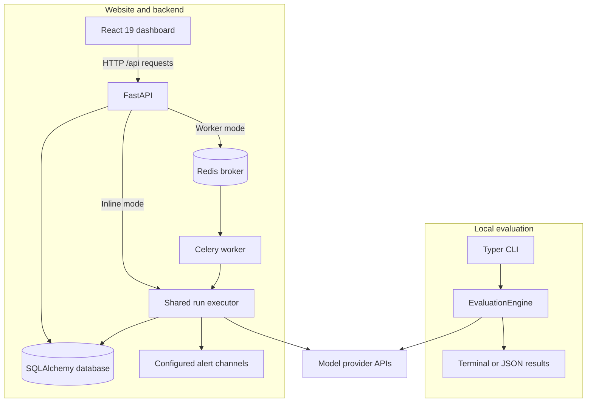
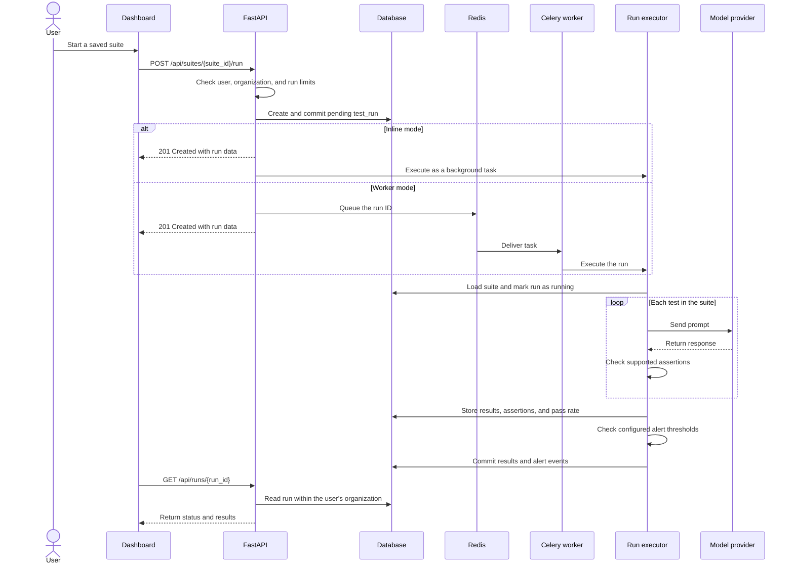
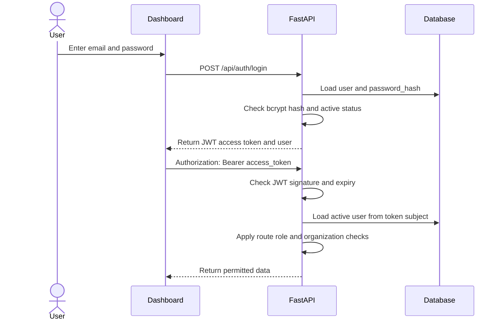
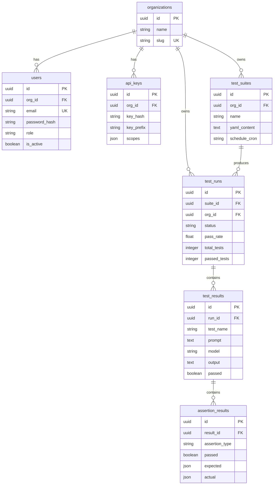

# DriftWatch architecture and code guide

This guide describes the code in this repository. The deployment files are configuration examples; they do not confirm which services are running on a live server.

## System overview

DriftWatch has two execution paths. The Python CLI runs evaluations locally and calls model providers directly. The React website sends requests to the FastAPI backend, which stores suites and results through SQLAlchemy.



The shared executor is a Python function, not a separate service. With `ENABLE_INLINE_RUNS=true`, a FastAPI background task calls it in the API process. With `ENABLE_INLINE_RUNS=false`, a Celery worker calls it. Redis provides the Celery broker and result backend.

PostgreSQL is configured in the deployment files. Local development defaults to SQLite, and API tests use an in-memory SQLite database.

| Component | Source | Purpose |
| --- | --- | --- |
| CLI | [cli/main.py](../driftwatch/cli/main.py) | Load a YAML suite, run it locally, and print results |
| Local evaluation library | [eval/engine.py](../driftwatch/eval/engine.py) | Call providers and check assertions |
| API | [api/routes.py](../backend/app/api/routes.py) | Handle users, suites, runs, alerts, policies, and datasets |
| Authentication | [services/auth.py](../backend/app/services/auth.py) | Check access tokens, API keys, and required roles |
| Database | [database.py](../backend/app/database.py), [models.py](../backend/app/models.py) | Manage async sessions and database models |
| Web run executor | [services/run_executor.py](../backend/app/services/run_executor.py) | Run saved suites and store results |
| Worker | [worker/runner.py](../backend/worker/runner.py) | Receive queued runs and call the shared executor |
| Dashboard | [frontend/src](../frontend/src) | Show suites, runs, results, and settings |

## Website evaluation flow



The run detail page [polls every two seconds](../frontend/src/pages/RunDetailPage.tsx) while a run is pending or running. It uses HTTP requests.

The web executor checks text, length, regular expression, JSON schema, latency, and cost assertions. The supported list is in [suite_validation.py](../backend/app/services/suite_validation.py). Cost estimates need a configured model price.

### Drift and alerts

The web backend records completed-run pass rates in `drift_scores`. The drift endpoint builds its timeline from completed runs. See [RunService](../backend/app/services/runs.py) and [the API routes](../backend/app/api/routes.py).

The local `driftwatch drift` command compares the current evaluation with saved JSON results. Its [statistics module](../driftwatch/eval/statistics.py) contains distribution, trend, and pass-rate calculations. This local path is separate from the website's stored pass-rate timeline.

[AlertService](../backend/app/services/alerts.py) checks enabled rules for the run's organization and suite. It sends an alert when `pass_rate` or `total_tests` falls below the configured threshold. Supported channels are Slack, email, PagerDuty, and Jira. It records whether each send succeeded or failed.

### Scheduled runs

- [scheduler.py](../backend/app/scheduler.py) uses APScheduler and each suite's `schedule_cron` expression when `ENABLE_INLINE_SCHEDULER=true`.
- [scheduler_cron.py](../backend/app/scheduler_cron.py) is an external entry point. Each call queues all active suites that have a schedule value. It currently does not check whether each suite's cron expression is due.
- [render.yaml](../render.yaml) calls that external entry point every five minutes. Its behavior therefore differs from the in-process scheduler.
- Docker Compose includes a Celery Beat process, but the worker code does not define a Beat schedule for suites.

## Authentication and authorization

### Password login



Passwords are stored as bcrypt hashes. The login endpoint returns an HS256 JWT access token. Its default lifetime is 60 minutes, set by `ACCESS_TOKEN_EXPIRE_MINUTES`. The current implementation has no refresh-token flow.

### API keys

API requests can also use `Authorization: Bearer dw_...`. [auth.py](../backend/app/services/auth.py) hashes the supplied key with SHA-256, finds the stored hash, checks expiry, and updates the last-use time.

Keys belong to an organization. The current implementation resolves a valid key to an admin user in that organization. The `scopes` field is stored, but it is not enforced by the authentication function. API keys therefore do not provide separate per-scope access controls.

### Access checks

[require_role](../backend/app/services/auth.py) is a FastAPI dependency. Routes use `require_role("admin")` for operations such as member management and API-key changes. Other routes require an authenticated user and check the user's organization when they read or change a resource.

This is a set of route-specific checks. The code does not enforce a complete read-only permission set for the `viewer` role across all routes.

When `PUBLIC_DEMO_MODE=true`, `/api/auth/demo` returns access to a shared demo user and organization. This is a shared demo session, not a separate account for each visitor. The API applies demo restrictions and run limits.

## Database model

[models.py](../backend/app/models.py) defines 14 tables. The diagram shows the main tables and selected columns. The remaining tables are listed below it. IDs use SQLAlchemy's `Uuid` type; JSON fields use its `JSON` type.



| Other table | Stored data | Foreign keys |
| --- | --- | --- |
| `drift_scores` | Metric name, value, and time | `suite_id`, `run_id` |
| `alert_configs` | Channel, destination, threshold, and enabled state | `org_id`, optional `suite_id` |
| `alert_events` | Alert message and send status | `alert_config_id`, `run_id` |
| `audit_logs` | User action, resource, details, and time | `org_id`, `user_id` |
| `policies` | Metric, operator, threshold, and action | `org_id`, optional `suite_id` |
| `datasets` | Dataset content, version, and row count | `org_id` |
| `prompt_versions` | Suite YAML versions and change notes | `suite_id`, `created_by` |

## Migrations

The repository has one Alembic revision: [001_initial.py](../backend/alembic/versions/001_initial.py). Its `upgrade()` creates the 14 tables and their indexes. It creates parent tables before tables with foreign keys to them. Its `downgrade()` drops the tables in reverse order and removes their data.

[alembic/env.py](../backend/alembic/env.py) imports the models and uses `Base.metadata` for schema comparison. It reads `DATABASE_URL` and creates an async engine. Set an async database URL, such as `postgresql+asyncpg://...`, before running a migration.

From a development checkout with the backend dependencies installed:

```bash
cd backend
alembic upgrade head
```

This command applies pending revisions to the selected database. It does not create a database server.

`AUTO_CREATE_SCHEMA=true` makes API startup call `Base.metadata.create_all()`. That can create missing tables, but it does not apply Alembic revisions or update existing columns. The Render configuration disables this option and runs Alembic before API deployment.

## Tests and code walkthrough

Start with these files when reviewing the backend:

| Area | Read this code | What to follow |
| --- | --- | --- |
| Login and roles | [auth.py](../backend/app/services/auth.py), [routes.py](../backend/app/api/routes.py) | Password check, access token, current user, and `require_role` dependency |
| Organization access | [test_api_routes.py](../backend/tests/test_api_routes.py) | `test_suite_run_and_ci_access_are_scoped_to_user_org` and `test_alert_policy_dataset_and_event_access_are_scoped_to_user_org` |
| Models and migration | [models.py](../backend/app/models.py), [001_initial.py](../backend/alembic/versions/001_initial.py) | Table fields, foreign keys, creation order, and rollback order |
| Run execution | [run_executor.py](../backend/app/services/run_executor.py), [test_run_executor.py](../backend/tests/test_run_executor.py) | Saved results, failed provider calls, supported assertions, and run limits |
| Test database | [conftest.py](../backend/tests/conftest.py) | In-memory SQLite and the overridden database dependency |

The API tests use Pytest, pytest-asyncio, and HTTPX's in-process ASGI transport. They cover registration, login, suite operations, organization access, and demo restrictions. Executor tests replace provider calls with test doubles.

The API fixtures create and drop tables with SQLAlchemy metadata. These tests do not run Alembic or prove that migrations work against PostgreSQL. They also do not establish complete permission coverage for every role and route.

After installing `.[dev]` and `backend/requirements.txt`, run the existing suites from the repository root:

```bash
pytest tests/ backend/tests/ -v
```

The [CI workflow](../.github/workflows/ci.yml) runs Python lint checks and tests, frontend lint and build checks, and a Docker Compose build. Check the workflow results for the commit you are reviewing.

## API details

- Application routes use the `/api` prefix.
- FastAPI's interactive docs are at `/docs` and `/redoc`.
- Paginated list routes use `page` and `limit`, with database offsets.
- Route errors use FastAPI's JSON `detail` field.
- The run trigger returns `201 Created` with the pending run.
- [rate_limit.py](../backend/app/rate_limit.py) configures SlowAPI; Redis is not configured there as a rate-limit store.

## Deployment files

| File | Configured services and behavior |
| --- | --- |
| [koyeb.yaml](../koyeb.yaml) | Demo API and PostgreSQL; evaluations run in the API process; no worker or cron service |
| [render.yaml](../render.yaml) | API, Celery worker, Redis, PostgreSQL, and external cron entry point; API migrations run before deployment |
| [docker-compose.yml](../docker-compose.yml) | Local API, worker, Beat process, PostgreSQL, Redis, frontend, Prometheus, and Grafana |
| [frontend/vercel.json](../frontend/vercel.json) | Frontend deployment; `VITE_API_URL` selects the backend |
| [infra](../infra) | Additional infrastructure and monitoring templates |

Use [the README](../README.md) for setup options. A configured service or passing local test is not proof of a successful live deployment.
